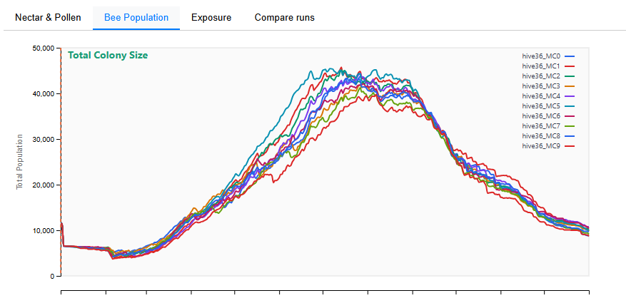
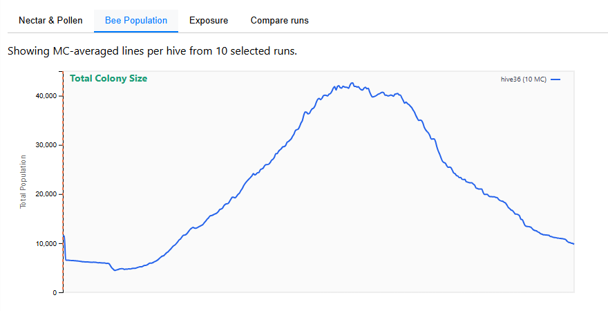

# Bee Population Charts

The **Bee Population** tab shows how the simulated honey bee colony evolves over time. Data comes from the **BEEHAVEecotox** model output (`output.csv`), which reports daily colony metrics.

<!-- SCREENSHOT: Bee Population tab showing multiple colony metric lines (total colony, adults, eggs, larvae, pupae) -->

## Colony Metrics

Five metrics can be toggled on and off from the sidebar under the **Bee Population** section:

| Metric | Sidebar label | What it represents |
|--------|--------------|-------------------|
| **Total Colony** | Total Colony | All bees + all brood: workers, foragers, eggs, larvae, and pupae combined |
| **Adults (Workers)** | Adults (Workers) | In-hive bees + foragers (the adult worker population) |
| **All Eggs** | All Eggs | Worker eggs + drone eggs |
| **All Larvae** | All Larvae | Worker larvae + drone larvae |
| **All Pupae** | All Pupae | Worker pupae + drone pupae |

Each metric is a **sum of sub-populations** from the BEEHAVE model:

$$
\text{Total Colony} = \text{TotalIHbees} + \text{TotalForagers} + \text{TotalEggs} + \text{TotalLarvae} + \text{TotalPupae}
$$

$$
\text{Adults} = \text{TotalIHbees} + \text{TotalForagers}
$$

$$
\text{All Eggs} = \text{TotalDroneEggs} + \text{TotalEggs (worker)}
$$

(And similarly for larvae and pupae.)

## Multi-run display

When multiple runs are selected via the **View** chips in the header, each run is shown as a separate coloured line. This lets you visually compare colony trajectories across different simulation runs (e.g. different hive locations or MC replicates).

### Display modes

A **Display** dropdown above the chart controls how lines are aggregated:

| Mode | Behaviour |
|------|-----------|
| **Individual MC runs** | One line per selected run. Each line shows the mean across BEEHAVE replicates within that single run. |
| **Average MC runs per hive** | Runs sharing the same hive location and treatment status are averaged first, producing one line per hive group. Useful when you have multiple Monte Carlo landscape realisations per hive. |

<!-- SCREENSHOT: Bee Population tab in "Average MC runs per hive" mode, showing fewer, smoother lines -->

## Interpreting the charts

A healthy colony typically shows:

- **Eggs, larvae, pupae** peaking in spring and summer when the queen is actively laying
- **Adults** increasing through spring, peaking in summer, then declining into autumn
- **Total colony** following a seasonal bell curve

In treated scenarios, look for:

- **Reduced peak population** compared to the untreated baseline
- **Delayed or suppressed spring build-up**
- **Earlier autumn decline** or colony collapse
- **Overwintering colony size** — does the colony survive to the following spring?

## Data source

Colony metrics come from the BEEHAVE model's `output.csv`, which records daily population counts for each bee caste and life stage. Each simulation run may contain multiple replicates with different random seeds, providing a range of possible colony trajectories for the same environmental conditions.
