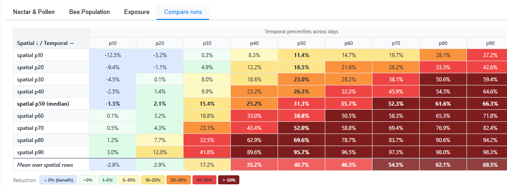

# Compare Runs

The **Compare Runs** tab provides a quantitative assessment of how much a pesticide treatment affects the bee colony relative to an untreated baseline. It pairs treated and untreated simulation runs sharing the same hive location and landscape realisation, then summarises the difference.

<!-- SCREENSHOT: Compare Runs tab showing the reduction matrix with paired runs selected -->

## How pairing works

BeeView automatically pairs runs based on:

1. **Hive location** — runs must share the same `hive_group_id` (same geographic position)
2. **Landscape realisation** — runs must share the same `outer_mc_id` (same Monte Carlo landscape sample)
3. **Treatment status** — one run must be untreated (baseline) and the other treated (scenario)

Within each pair, BEEHAVE **replicates** (stochastic colony runs) are matched by index. Because paired runs share the same random seed, replicate *i* in the treated run experienced identical initial conditions as replicate *i* in the untreated run.

!!! tip "Selecting runs for comparison"
    Use the **View** chips in the header to select at least one untreated and one treated run from the same hive group. The matrix appears automatically once valid pairs are found.

## Colony-Size Reduction Matrix

The main visualisation is a **9×9 percentile matrix** showing the actual percent-reduction of the treated colony relative to the untreated colony.

<!-- SCREENSHOT: Close-up of the 9×9 reduction matrix table with colour-coded cells -->

### How it is computed

For each paired run (one untreated, one treated):

**Step 1 — Daily reduction per replicate pair**

For each day $d$ and each replicate pair $i$:

$$
r_i(d) = \frac{B_i(d) - S_i(d)}{B_i(d)}
$$

Where $B_i(d)$ is the baseline (untreated) colony size and $S_i(d)$ is the scenario (treated) colony size. A positive value means the treated colony is smaller.

If the baseline is zero on a given day (both colonies are zero), the reduction is defined as 0.

**Step 2 — Average across replicates**

The daily mean reduction for each landscape pair:

$$
\bar{r}(d) = \frac{1}{N_{\text{replicates}}} \sum_{i=1}^{N_{\text{replicates}}} r_i(d)
$$

This produces one daily reduction time series per spatial unit (hive location × landscape realisation).

**Step 3 — Temporal percentiles**

For each spatial unit, compute temporal percentiles (p10, p20, … p90) across all days. These summarise "how bad is the reduction on typical days vs. worst days":

- **Temporal p10** = the reduction on a relatively "good" day (only 10% of days are lower)
- **Temporal p50** = the median daily reduction
- **Temporal p90** = the reduction on a "bad" day (90% of days have lower reduction)

**Step 4 — Spatial percentiles**

Across all spatial units, compute spatial percentiles of each temporal percentile. These summarise "how many locations are affected":

- **Spatial p10** = a location where effects are mild (only 10% of locations are less affected)
- **Spatial p50** = the median location
- **Spatial p90** = a severely affected location

The resulting matrix cell at row `spatial pS` and column `temporal pT` means:

> "For **S%** of hive locations, the **T-th percentile** across days of the colony-size reduction is at or below this value."

### Reading the matrix

| Cell value | Interpretation |
|-----------|---------------|
| **0%** | No effect — treated colony is the same size as untreated |
| **5–10%** | Mild reduction |
| **10–20%** | Moderate reduction |
| **20–30%** | Significant reduction |
| **> 30%** | Severe reduction |
| **Negative** | Treated colony is *larger* than untreated (stochastic variability) |

### Colour scale

| Colour | Range |
|--------|-------|
| Blue | < 0% (treated colony larger — benefit) |
| White/light green | ~0% (no meaningful effect) |
| Light green | 1–5% reduction |
| Yellow | 5–10% reduction |
| Amber/orange | 10–20% reduction |
| Dark orange | 20–30% reduction |
| Red | 30–50% reduction |
| Dark red | > 50% reduction |

### Spatial scope selector

A **percentile scope** dropdown controls how the spatial dimension is defined:

| Mode | Description |
|------|-------------|
| **pair (each MC pair)** | Each baseline/scenario pair is a separate spatial unit. If you have 5 hive locations × 2 MC realisations, you get 10 spatial units. |
| **hive mean (aggregate MC first)** | MC realisations for the same hive location are averaged first, then spatial percentiles are computed across hive locations only. |

