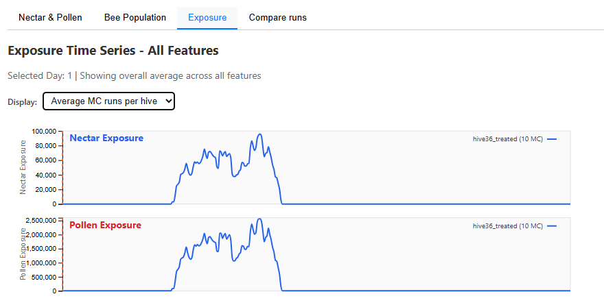

# Exposure Charts

The **Exposure** tab shows time series of pesticide contamination in nectar and pollen for the selected runs and landscape features.

<!-- SCREENSHOT: Exposure tab showing nectar_exposure and pollen_exposure time series with application timeline markers -->

## Prerequisites

To view exposure data:

1. **Select runs** using the View chips in the header — at least one run must be selected.
2. Optionally **select map features** to restrict the exposure calculation to specific parcels. If no features are selected, exposure is computed across all features in the landscape.

!!! note
    If no runs are selected, the tab displays a message asking you to select runs. This prevents loading default data that may not match the intended analysis.

## What is displayed

Two time-series panels are shown:

| Chart | Metric | Unit |
|-------|--------|------|
| **Nectar Exposure** | Daily pesticide concentration in nectar | Relative units from the applications file |
| **Pollen Exposure** | Daily pesticide concentration in pollen | Relative units from the applications file |

## How exposure is computed

Exposure values are derived from the `applications.txt` file associated with each simulation run. Each application event specifies:

- The target feature (parcel) ID
- The day of application
- The nectar and pollen contamination concentrations

For each application event, the contamination is **extended over 9 consecutive days** (the application day plus 8 following days) to model residual exposure. When multiple applications overlap in time on the same feature, their concentrations are **summed**.

The displayed time series shows the total exposure aggregated across all selected features for each day.

## Application timeline

Vertical markers on the chart indicate **individual application events** — the day when a pesticide was applied. These markers help correlate exposure peaks with specific treatment actions.

## Display modes

When multiple runs are selected, a **Display** dropdown controls line aggregation:

| Mode | Behaviour |
|------|-----------|
| **Individual MC runs** | One line per selected run |
| **Average MC runs per hive** | MC replicates for the same hive location and treatment are averaged into a single line |

## Data source

Each simulation run stores its pesticide applications in a separate file (`applications.txt`) within the run's output folder. The file lists application events with feature IDs, timing, and contamination levels for nectar and pollen. BeeView-server reads these per-run files and computes the exposure time series on request.
