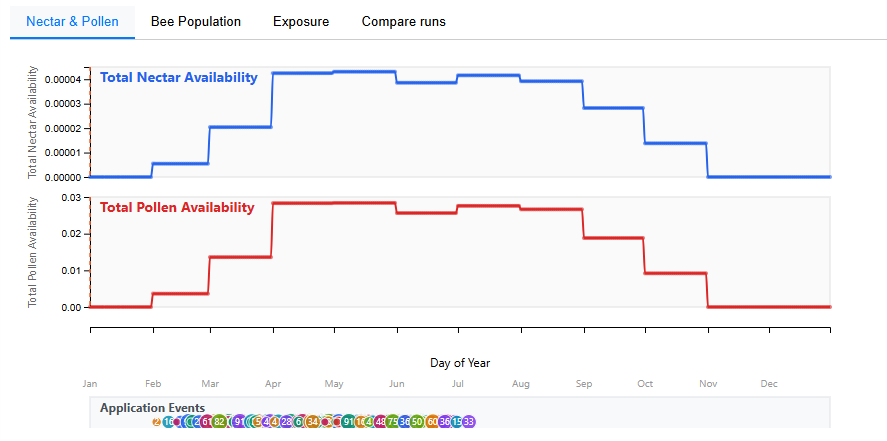

# Nectar & Pollen Charts

The **Nectar & Pollen** tab (the first tab in the chart panel) shows daily average nectar and pollen availability across the landscape over the simulation period.

<!-- SCREENSHOT: Nectar & Pollen tab with both nectar and pollen time series visible, showing seasonal curves -->

## What is displayed

Two time-series charts are shown in a stacked ("trellis") layout, one for each visible forage metric:

- **Total Nectar Availability** (blue line) — the daily average nectar production across all features, in L/m²/day.
- **Total Pollen Availability** (red line) — the daily average pollen production across all features, in g/m²/day.

Each chart can be independently toggled using the **Nectar** and **Pollen** checkboxes in the sidebar.

## How the average is computed

For each day $d$ in the simulation:

$$
\bar{N}(d) = \frac{1}{|F|} \sum_{f \in F} N_f(d)
$$

Where:

- $F$ is the set of selected features (or all features if none are selected)
- $N_f(d)$ is the nectar (or pollen) value for feature $f$ on day $d$
- The result is the **arithmetic mean** across features

!!! note "Selection filtering"
    When you click on map features to select them, only the selected features contribute to the average. If no features are selected, the average is computed over all features in the landscape.

## Application timeline

If simulation runs with pesticide applications are selected, vertical markers appear on the time-series chart showing **when and where applications occur**. Each marker represents a pesticide application event from the run's `applications.txt` file.

This helps correlate drops in forage availability (if any) with the timing of treatments.

## Time point selection

Click on the chart or use the **left/right arrow keys** to move the selected day. The selected day:

- Is shown as a vertical line on the chart
- Updates the Nectar and Pollen map layers to reflect values on that specific day
- Is displayed in the status bar above the chart

## Data source

Nectar and pollen values come from the **BeeForage** component of xPollinator, which computes daily nectar (L/m²/day) and pollen (g/m²/day) for each landscape feature based on:

- The vegetation class assigned to each parcel
- Seasonal phenology tables that define flowering periods and resource production rates per vegetation type
