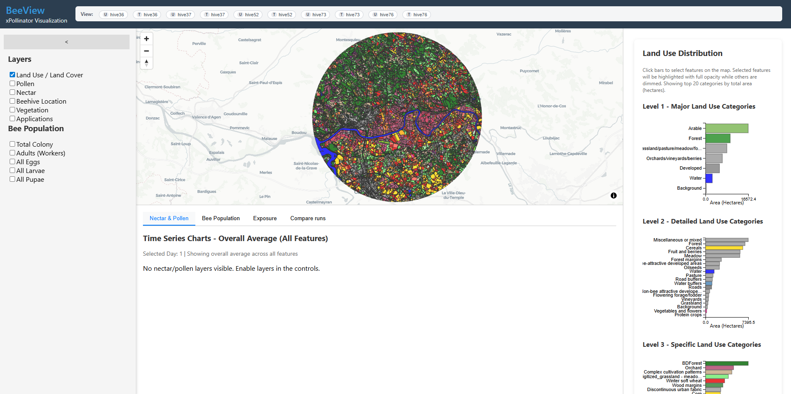

# BeeView User Guide

BeeView is an interactive visualization tool for exploring simulation results from **xPollinator**, the landscape-scale pollinator modelling framework. It displays spatial land-use data on an interactive map alongside time-series charts for nectar and pollen availability, bee colony dynamics, pesticide exposure, and cross-run comparisons.

<!-- SCREENSHOT: Full application window showing map, sidebar, and bottom chart panel -->

## What can I do with BeeView?

- **Explore landscape features** — pan and zoom across land-use parcels, colour-coded by crop type, vegetation class, nectar, or pollen intensity.
- **Inspect time series** — view daily nectar and pollen availability averaged over selected map features.
- **Monitor bee colonies** — track total colony size, adult workers, eggs, larvae, and pupae over the simulation period.
- **Assess pesticide exposure** — visualise nectar and pollen contamination time series for selected runs.
- **Compare treated vs. untreated runs** — quantify how much a pesticide treatment reduces colony size using a spatial × temporal percentile matrix.

## Interface Layout

The interface is divided into three areas:

| Area | Location | Purpose |
|------|----------|---------|
| **Sidebar** | Left panel | Layer toggles, land-use distribution histograms |
| **Map** | Centre | Interactive map with multiple overlay layers |
| **Chart panel** | Bottom | Four tabs: Nectar & Pollen, Bee Population, Exposure, Compare Runs |
| **Header** | Top bar | Run selection chips for multi-run analysis |

## Quick Start

1. Ensure the BeeView-server backend is running on port 32000.
2. Open BeeView in a browser at `http://localhost:8083` (dev) or launch the Electron app.
3. Toggle layers in the sidebar to colour the map by land use, nectar, pollen, or vegetation.
4. Click on map features to select them — charts will update to show data for selected features.
5. Use the **View** chips in the header to select simulation runs for multi-run analysis.

## Documentation Sections

- [Map & Layers](map-layers.md) — how map layers work and what the colours mean
- [Nectar & Pollen Charts](charts-nectar-pollen.md) — daily forage availability time series
- [Bee Population Charts](charts-bee-population.md) — colony dynamics over time
- [Exposure Charts](charts-exposure.md) — pesticide contamination time series
- [Compare Runs](charts-compare.md) — the reduction matrix, Effect-Days, and survival analysis
- [Sidebar & Histograms](sidebar.md) — land-use distribution charts
- [Run Selection](run-selection.md) — working with multiple simulation runs
