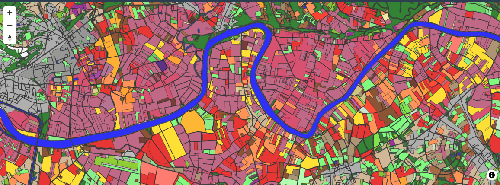
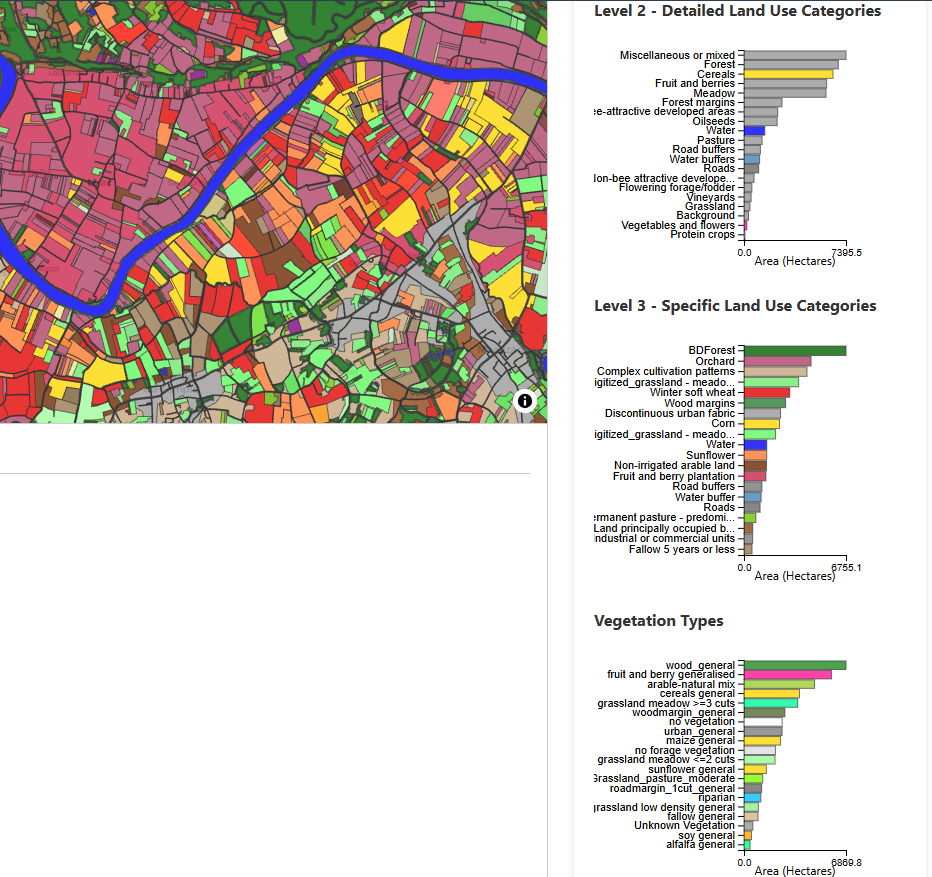
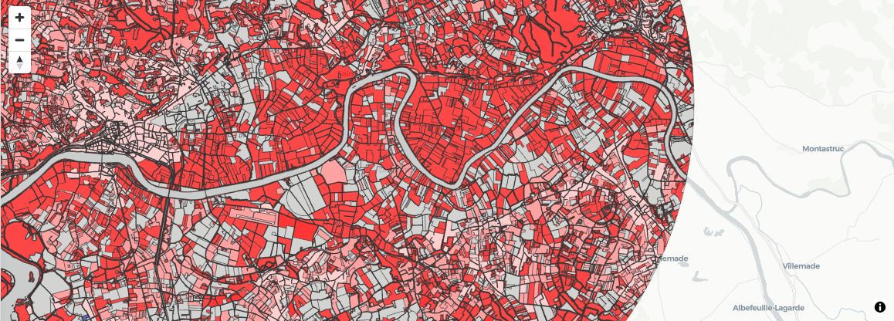
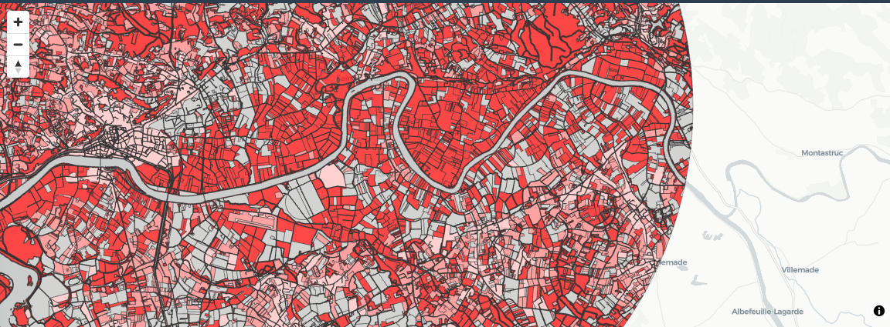
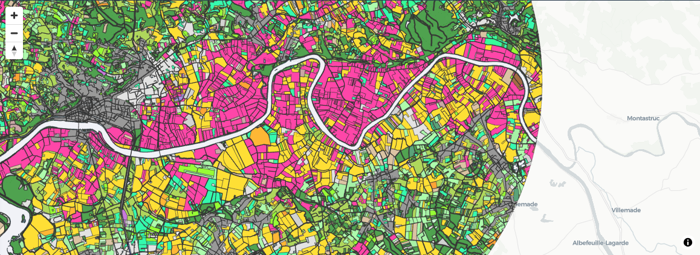
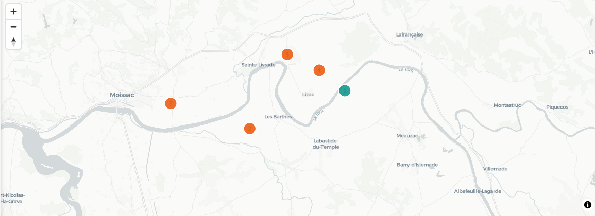
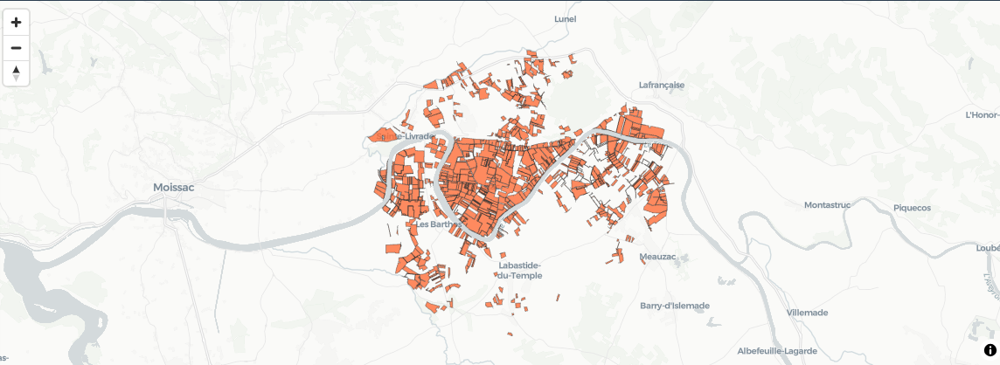

# Map & Layers

The central map panel uses [MapLibre GL](https://maplibre.org/) with [Deck.gl](https://deck.gl/) overlays to render land-use polygons from the xPollinator scenario shapefile. Multiple layers can be toggled independently from the sidebar.

<!-- SCREENSHOT: Map showing the default Land Use / Land Cover layer with coloured polygons -->

## Available Layers

### Land Use / Land Cover (LULC)

The default layer. Each polygon is coloured by its **Level 3 land-use class** — the most specific crop or land-cover category from the scenario shapefile.

Colours are assigned per category using a fixed palette. Examples:

| Category | Colour |
|----------|--------|
| Winter soft wheat | Dark red tones |
| Sunflower | Orange tones |
| Forest (broad-leaved) | Dark green |
| Meadow / Grassland | Light green |
| Water | Blue |
| Urban / Developed | Grey |

<!-- SCREENSHOT: Close-up of map with several land-use classes visible and the histogram legend on the right for reference -->

When features are **selected** (by clicking on the map), the selected polygons appear at full opacity while all other polygons are dimmed to 30% opacity. This helps visually identify which parcels contribute to the currently displayed charts.

### Nectar Layer

Colours each polygon by its **maximum daily nectar availability** (L/m²/day) across the simulation period (or the currently selected day, if a time point is chosen).

The colour ramp runs from **white** (no nectar, 0) to **deep red** (maximum nectar). The scale is linear.

$$
\text{colour intensity} = \frac{\text{nectar value}}{\text{max nectar}} \quad \in [0, 1]
$$

Where `max nectar` is a fixed reference value of approximately 0.000099 L/m²/day.

<!-- SCREENSHOT: Map with Nectar layer enabled, showing white-to-red gradient across polygons -->

### Pollen Layer

Identical colour logic to the Nectar layer, but based on **pollen availability** (g/m²/day). The gradient is also **white → red**, with a reference maximum of approximately 0.066 g/m²/day.

<!-- SCREENSHOT: Map with Pollen layer enabled -->

### Vegetation Layer

Colours each polygon by its assigned **vegetation class** from the xPollinator land-cover-to-vegetation mapping. Each vegetation type (e.g. `wood_general`, `cereals general`, `grassland meadow ≥3 cuts`) receives a distinct colour.

This layer shows the ecological functional grouping rather than the administrative land-use classification.

<!-- SCREENSHOT: Map with Vegetation layer enabled, showing distinct colours per vegetation type -->

### Beehive Location

When enabled, shows **coloured markers** at each beehive location for the currently selected runs:

- **Teal circles** — untreated (baseline) runs
- **Orange circles** — treated (scenario) runs

Each marker is labelled with a sequential hive number. Hovering over a marker shows the hive group name, treatment status, and how many MC replicates are selected for that hive.

<!-- SCREENSHOT: Map showing beehive markers with teal/orange dots and number labels -->

### Applications Layer

Highlights parcels that receive **pesticide applications** during the simulation. These parcels are overlaid with a semi-transparent orange fill so the underlying land-use colours remain partially visible.

This layer is useful for identifying which landscape features are treated and correlating them with nectar/pollen contamination visible in the Exposure tab.

<!-- SCREENSHOT: Map with Applications layer showing orange-highlighted parcels -->

## Interaction

### Selecting Features

Click on any polygon to **select** it. Selected features:

- Appear at full opacity while others dim
- Contribute to the Nectar & Pollen time-series average shown in the chart panel
- Filter the Exposure time series to show contamination only for selected parcels

Click on the map background (outside any polygon) or press the **Clear Selection** button to deselect all features.

### Navigation

- **Pan**: click and drag
- **Zoom**: scroll wheel, or use the +/− buttons in the top-right corner
- **Rotate**: right-click and drag (or use the compass button)
- **Keyboard**: Arrow keys change the selected day of year; Home/End jump to start/end

