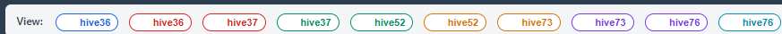

# Run Selection

BeeView supports viewing and comparing multiple simulation runs simultaneously. This is essential for:

- Comparing treated vs. untreated scenarios
- Examining variability across Monte Carlo landscape realisations
- Analysing multiple hive locations in the same landscape

<!-- SCREENSHOT: Header bar showing View chips with U/T prefixes and hive group names -->

## View Chips

The header bar displays one **chip** per available run, grouped by hive location. Each chip shows:

- **U** prefix (teal) — untreated run
- **T** prefix (orange) — treated run
- **Hive name** — the `hive_group_id` identifying the spatial location

Click chips to toggle them on/off. Selected (active) chips are highlighted. The **clear** button deselects all chips.

## What changes when runs are selected

| Tab | Behaviour |
|-----|-----------|
| **Nectar & Pollen** | Application timeline markers update to show events from selected runs |
| **Bee Population** | One line per selected run (or per hive group in hive-mean mode) |
| **Exposure** | Exposure time series shown for selected runs only. Requires at least one chip to be active. |
| **Compare Runs** | Automatically pairs untreated/treated runs and computes the reduction matrix |
| **Map (Beehive layer)** | Markers appear for all selected runs' hive locations |

## Pairing logic

For the Compare Runs tab, BeeView automatically finds valid pairs:

1. Among the selected chips, group runs by `hive_group_id` and `outer_mc_id`
2. Within each group, pair the untreated run with the treated run
3. Groups that lack either a treated or untreated counterpart are skipped

!!! example
    If you select:
    
    - U hive36 (MC1), T hive36 (MC1)
    - U hive36 (MC2), T hive36 (MC2)
    - U hive76 (MC1), T hive76 (MC1)
    
    This produces 3 valid pairs across 2 hive locations and 2 MC realisations for hive36.

## Monte Carlo replicates

Each imported run may contain multiple BEEHAVE **replicates** (stochastic colony simulations with different random seeds). These are handled automatically:

- In the **Bee Population** tab, each line shows the **mean across replicates** for that run
- In the **Compare Runs** tab, replicates are **paired by index** (replicate 0 treated with replicate 0 untreated) to form a proper paired-difference design before averaging

## Importing runs

Simulation runs are imported into BeeView-server using the `import_run.py` script. Each imported run records:

- Simulation ID, hive coordinates, treatment status
- Monte Carlo metadata (outer MC ID, random seed)
- Source path to the original xPollinator output

See the BeeView-server documentation for details on importing runs and managing the database.
