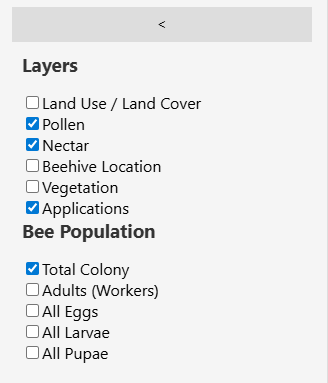
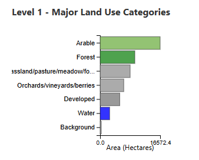
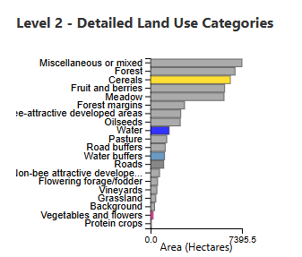
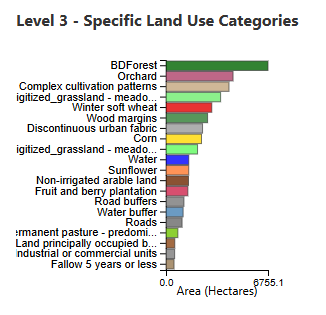
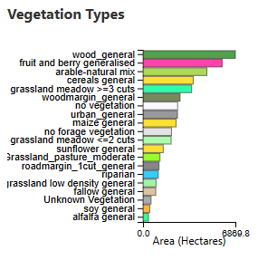

# Sidebar & Histograms

The left sidebar provides **layer controls** and **land-use distribution histograms** that summarise the landscape composition.

<!-- SCREENSHOT: Full sidebar showing layer toggles at the top and histograms below -->

## Layer Controls

The upper section of the sidebar contains checkboxes to toggle map layers on and off. Each checkbox independently controls a Deck.gl layer rendered on the map.

**Map layers:**

- Land Use / Land Cover
- Pollen
- Nectar
- Beehive Location
- Vegetation
- Applications

**Bee Population layers** (controls which metrics are shown in the Bee Population chart):

- Total Colony
- Adults (Workers)
- All Eggs
- All Larvae
- All Pupae

## Land-Use Distribution Histograms

Below the layer controls, four horizontal bar charts show the **area breakdown** of the landscape at different classification levels.

### Level 1 — Major Land Use Categories

<!-- SCREENSHOT: Level 1 histogram showing major categories (Arable, Forest, Grassland, etc.) -->

Shows the broadest land-use groupings: Arable, Forest, Grassland/pasture/meadow, Orchards/vineyards, Developed, Water, and Background. Each bar represents the **total area in hectares** occupied by that category.

### Level 2 — Detailed Land Use Categories

<!-- SCREENSHOT: Level 2 histogram showing more specific categories (Cereals, Fruit and berries, Meadow, etc.) -->

A more granular breakdown. For example, "Arable" expands into Cereals, Oilseeds, Protein crops, etc.

### Level 3 — Specific Land Use Categories

<!-- SCREENSHOT: Level 3 histogram showing the most specific crop types (Winter soft wheat, Sunflower, etc.) -->

The most detailed level — individual crop types or specific land-cover classes as defined in the scenario shapefile.

### Vegetation Types

<!-- SCREENSHOT: Vegetation type histogram showing categories like wood_general, cereals general, grassland meadow, etc. -->

Shows the area distribution by **vegetation functional class** as assigned by the xPollinator land-cover-to-vegetation mapping. These are the ecologically meaningful groupings that determine nectar and pollen production.

## Interacting with histograms

**Click on a bar** in any histogram to **select all features** of that land-use or vegetation type on the map. Selected features are highlighted with full opacity, and the charts update to show averages for only those features.

This provides a quick way to answer questions like "What does the nectar time series look like for all forest parcels?" or "How much area is covered by sunflower?"

!!! tip
    The histograms show the **top 20 categories** by total area. Categories with very small areas are omitted for readability.
